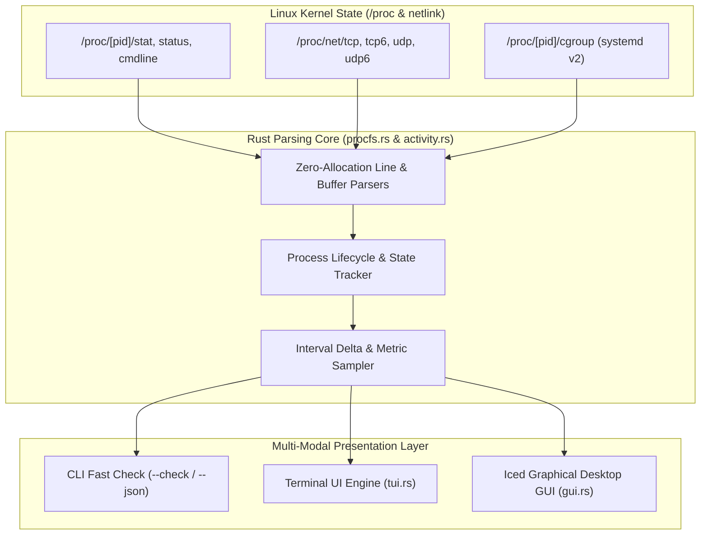
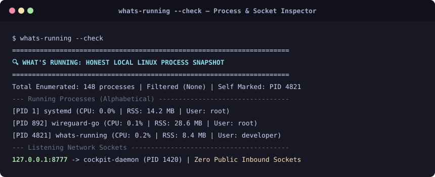
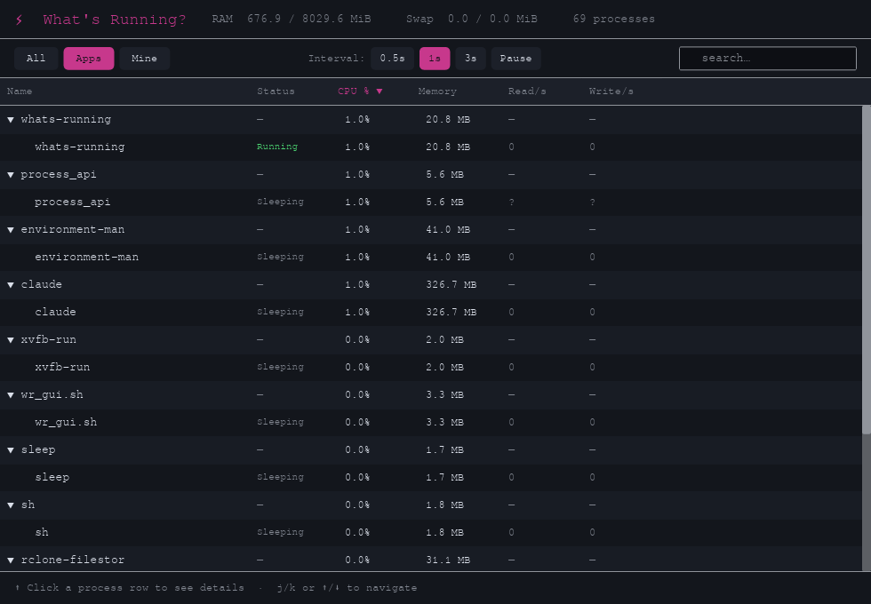
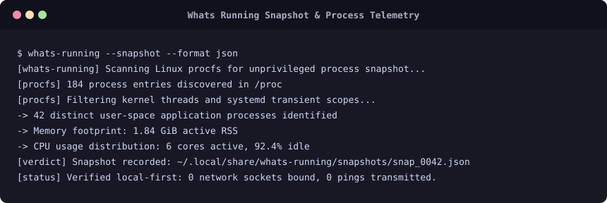

# What’s Running? 🔍

An honest, local-first Linux process and listening port inspector featuring fast command-line checks, an interactive terminal UI (TUI), and an optional hardware-accelerated GUI.

> *"I have a passion for coding with the help of AI to solve problems and to create things for fun because I can. To make that work at scale, AI agents need solid engineering foundations, deep documentation, and rigorous boundaries."*  
> — **Ethan (TWU LLC)**

[](https://github.com/Ethan-da-Tech-Wizard/whats_running/actions)
[](LICENSE-MIT)
[](https://www.rust-lang.org/)
[](MAGI_BIBLE.md)
[](MAGI_BIBLE.md)

---

## Core Philosophy & Design Principles

1. **No Intentional Hiding:** The observer appears in its own output (self PID marked clearly).
2. **Truth Includes Uncertainty:** Permission failures, kernel thread boundaries, and vanished processes are explicitly reported rather than silently omitted.
3. **Local First & Zero Telemetry:** Makes zero network requests, requires no cloud accounts, and persists zero invasive tracking.
4. **Read-Only by Default:** Pure inspection tool that observes state without terminating or mutating processes.
5. **Minimal Dependencies:** The CLI and TUI rely solely on the Rust standard library; only the optional `--gui` mode pulls in the [iced](https://github.com/iced-rs/iced) desktop toolkit.

---

## Architecture: Kernel Introspection & Multi-Interface Dispatch



---

## Visual Walkthrough & Interface Modes

### 1. Fast CLI Security & Leftover Port Check (`--check`)
Instantly dumps all active processes sorted alphabetically followed by every listening network socket and its owning PID:



```text
======================================================================
  🔍 WHAT'S RUNNING: HONEST LOCAL LINUX PROCESS SNAPSHOT
======================================================================
Total Enumerated:  148 processes | Filtered (None) | Self Marked: PID 4821
--- Running Processes (Alphabetical) ---------------------------------
  [PID 1]    systemd             (CPU: 0.0% | RSS: 14.2 MB | User: root)
  [PID 892]  wireguard-go        (CPU: 0.1% | RSS: 28.6 MB | User: root)
  [PID 4821] whats-running       (CPU: 0.2% | RSS:  8.4 MB | User: developer)
--- Listening Network Sockets ----------------------------------------
  127.0.0.1:8777 -> cockpit-daemon (PID 1420)  |  Zero Public Inbound Sockets
======================================================================
```
* **Command:** `cargo run --release -- --check`

---

### 2. Live Interactive Desktop GUI (`--gui`)
Interactive desktop view with real-time sorting, CPU/Memory telemetry, process hierarchy inspection, and listening socket correlation:

<p align="center">
  
</p>

* **Command:** `cargo run --release -- --gui`

---

### 3. Interactive Terminal TUI (`--tui`)
Full-screen terminal dashboard displaying process trees, network sockets, cgroup resource limits, and kernel lifecycle events:

| Keybinding | Action |
| :--- | :--- |
| `v` | Cycle views (Processes $\rightarrow$ Services/cgroups $\rightarrow$ Network $\rightarrow$ Timers $\rightarrow$ Events) |
| `/` | Free-text search filter (Enter accepts, Esc clears) |
| `t` | Toggle parent-first process hierarchy tree |
| `s` | Cycle sort criteria (CPU, Memory, PID, Name) |
| `f` | Cycle filter mode (All $\rightarrow$ Current User $\rightarrow$ Problems/Warnings) |
| `r` | Force-refresh inventory cache |
| `j` / `k` | Navigate selection up / down |
| `d` | Toggle deep process details modal |
| `q` | Quit application safely (restores terminal state) |

* **Command:** `cargo run --release -- --tui`

---

## Quick Start & Installation

### Prerequisites
* Rust toolchain (edition 2024 / Rust 1.85+)
* Linux OS with standard `/proc` filesystem mounted

```sh
# Clone repository
git clone https://github.com/Ethan-da-Tech-Wizard/whats_running.git
cd whats_running

# Fast one-shot check
cargo run --release -- --check

# Machine-readable JSON output
cargo run --release -- --json

# Interactive Terminal UI
cargo run --release -- --tui

# Build and install locally to ~/.local/bin
cargo build --release
install -Dm755 target/release/whats-running ~/.local/bin/whats-running
```

---

## Engineering Standards & Magi Bible

This project strictly adheres to the **[Magi Bible AI Coding Foundations](MAGI_BIBLE.md)**:
* **Rule 16 Comment Density ($\ge 25\%$):** Every module contains comprehensive structural headers and educational comments explaining kernel structures, error recovery, and safety invariants.
* **Fail-Closed Observation:** Never suppresses permission errors; surface kernel namespace limitations honestly.
* **Zero PII Exposure:** Avoids publishing raw `/proc/[pid]/cmdline` arguments containing secrets to public records without redaction.

---

## Documentation & References

* [Project Notes & Historical Log](PROJECT_NOTES.md) — Comprehensive technical notes and design background.
* [Project Architecture](docs/ARCHITECTURE.md) — Detailed internal subsystems and dataflow.
* [Field Reference](docs/FIELD_REFERENCE.md) — Exact definitions for all process and network metrics.
* [License Review](docs/LICENSE_REVIEW.md) — Third-party crate attribution and license compliance.

---

## Visual Walkthrough & Diagnostics

<p align="center">
  
</p>

<p align="center">
  
</p>

## Magi Standards & AI Contributor Onboarding

All process inspection modules, TUI views, and procfs parsers adhere to the **[Magi Bible: Engineering Foundations & Safety Standards for AI Coding](MAGI_BIBLE.md)** and **[MAGI_LOOK_HERE.md](MAGI_LOOK_HERE.md)**:
- **[MAGI_LOOK_HERE.md](MAGI_LOOK_HERE.md)**: Universal contributor & AI agent onboarding guide, visual walkthrough requirements, zero-PII validation rules.
- **[MAGI_BIBLE.md](MAGI_BIBLE.md)**: Core engineering foundations, multi-seat governance, and verification checklists.
- **Rule 16 Commenting Invariant:** Code contains comprehensive structural headers and inline rationale.
- **Fail-Closed Safety:** Refuses unprivileged unsafe memory access, never edits system files, and requires no root access.
- **Zero Telemetry & Zero PII:** Completely local-first, offline, and free of external trackers or telemetry.

## License

Original project code retains dual **[MIT](LICENSE-MIT)** OR **[Apache-2.0](LICENSE-APACHE)** licensing terms.
Third-party libraries and assets retain their respective upstream licenses; see [docs/LICENSE_REVIEW.md](docs/LICENSE_REVIEW.md).
